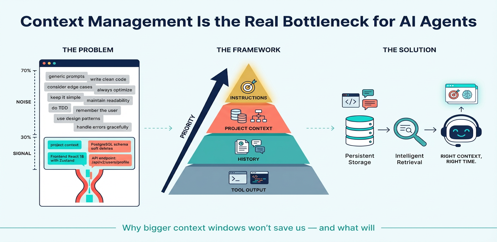
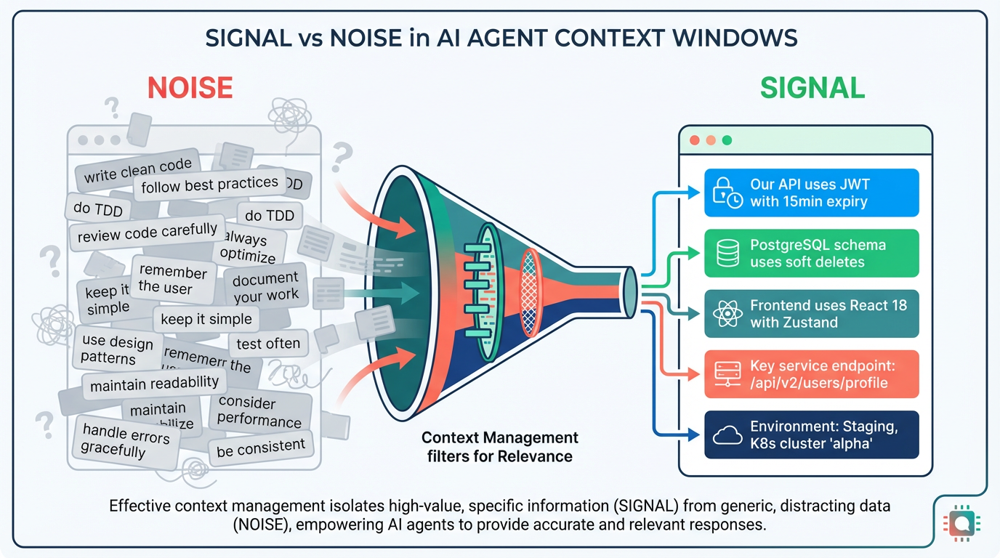
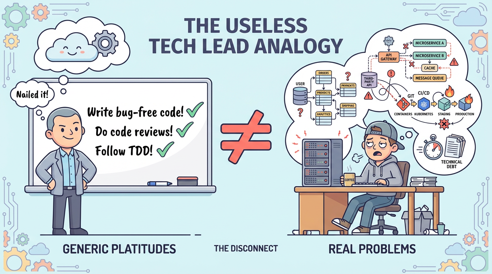
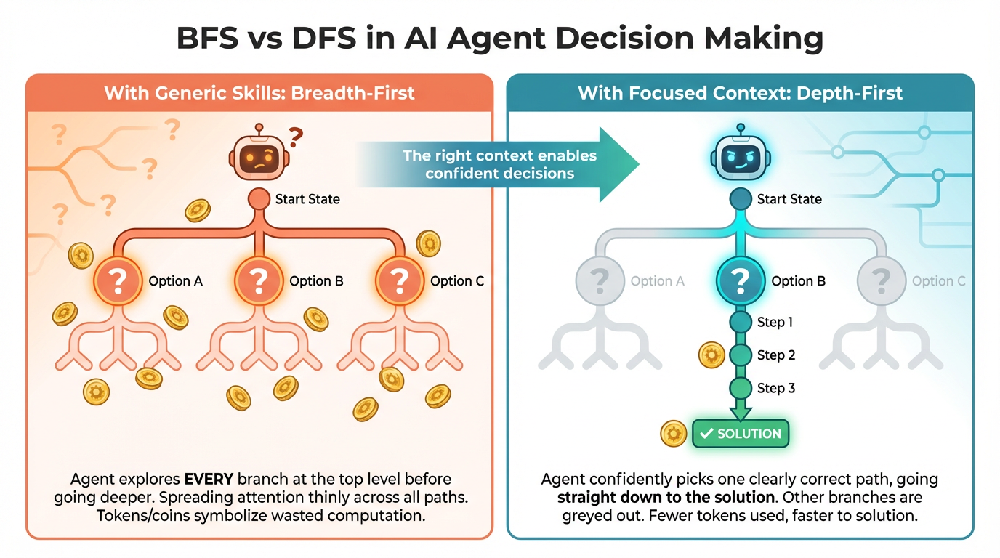
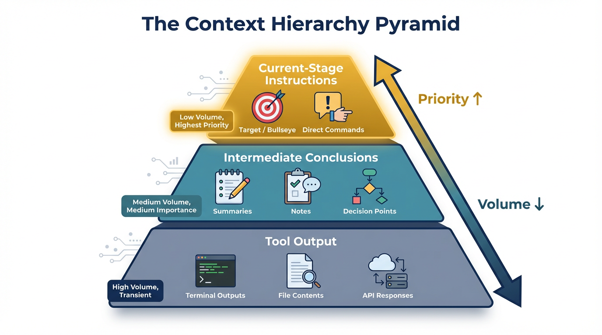
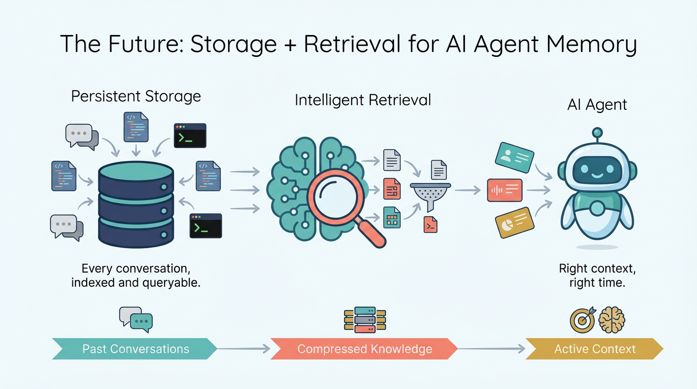

# Context Management Is the Real Bottleneck for AI Agents

Ever since Anthropic released MCP (Model Context Protocol), I've felt that this company has a uniquely sharp perspective on the model-to-user relationship. MCP gave agents a standardized way to *access* external tools and data. Then came Skills — reusable bundles of instructions and workflows that promised to make agents more "capable." Together, they represent two sides of the same coin: MCP expands what the agent can *do*; Skills shape how the agent *thinks*.

But after spending serious time building with both, I've arrived at a somewhat contrarian take: **the bottleneck isn't capability — it's context quality.** Most of what people add to their agent's context is noise, not signal. And the maturity of your project determines which side of that line any given piece of context falls on.

## A Maturity Model for Agent Context

Before I get into specifics, let me frame the core idea. The value of any piece of context depends on *where you are* in your project lifecycle:

**Early stage** — You're still exploring. Requirements are fuzzy, architecture is undecided. At this point, generic best-practice guidance (TDD workflows, clarification prompts, structured planning) is genuinely valuable. It provides scaffolding when you don't have your own.

**Growth stage** — Your project has taken shape. You have established patterns, specific constraints, non-obvious domain knowledge. Generic guidance starts *competing* with your hard-won project context for the model's attention.

**Mature stage** — You know exactly what you're building. Your `.claude.md`, Cursor rules, or Skills encode deep project-specific knowledge. At this point, generic context isn't just unhelpful — it actively degrades performance by diluting the signal the model needs.

The mistake most people make is treating context as universally good. It isn't. **Context has a shelf life, and its value is relative to what else is in the window.**

## The "Absolutely Correct but Utterly Useless" Prompt Problem

Before Skills became a thing, social media was flooded with people sharing magic prompts — "add this one line and your model's productivity goes up 10x!" My gut told me this was overblown, and after months of heavy coding with LLMs, I'm more certain than ever.

Here's the analogy: imagine a tech lead whose entire guidance to you is "write bug-free code, always consider edge cases, keep your code maintainable." These are all *correct* statements. They're also completely useless for your actual work. They carry zero information — they're the kind of universally true platitudes that apply to every project and every engineer. Which edge cases? Maintainable by what standard? For what audience? Without project-specific context, these instructions are noise shaped like signal.

Now, I should be precise about this analogy. When a tech lead tells a *human* engineer to "consider edge cases," it's useless because the human already knows they should — the instruction carries zero new information. With LLMs, the situation is subtly different: a generic instruction like "always consider edge cases" *can* measurably shift model behavior, because the model is statistically weighting its next token based on what's in context. So generic instructions aren't literally zero-information to a model the way they are to a human.

But here's the catch: that behavioral nudge comes at a real cost. Every token of generic guidance occupies space that could hold project-specific context. And as your project matures, the marginal value of "consider edge cases" drops toward zero while the value of "our payment API returns 429 when rate-limited — always implement exponential backoff with a 3-retry cap" only increases. The generic version makes the model *think about* edge cases in the abstract; the specific version tells it *exactly which edge case matters and how to handle it*. **The opportunity cost is what makes generic context harmful at scale.**

## What Actually Matters: Project-Specific Context

What you *should* be doing is extracting the **key differentiators** of your specific project through your interactions with the model. What makes your product unique? What are the non-obvious constraints the model needs to pay attention to? *That's* the real context worth preserving.

Whether you crystallize this into a `.claude.md` file, Cursor's MDC rules, or a proper Skill — the point is the same: **good context adds genuine information density.** It tells the model something it couldn't have inferred on its own.

Some examples of high-value context:
- Architectural decisions and their *rationale* ("We chose event sourcing because...")
- Non-obvious constraints ("The billing service has a 100ms SLA, so never add synchronous calls to it")
- Project-specific naming conventions and patterns that deviate from common defaults
- Known pitfalls ("Don't use `datetime.now()` — everything goes through our `TimeService` for testability")

## Depth-First vs. Breadth-First: When Generic Skills Backfire

This brings me to Superpowers, a very popular Skill in the community. The name alone tells you the author understands what people *want*. I gave it a real shot.

After using it on projects where I already had well-established context, I noticed something immediately: **the model became rigid.** With a smart model like Opus, there are situations where the right technical choice is overwhelmingly obvious. But with Superpowers loaded, the model would insist on presenting Option 1 / Option 2 / Option 3 and asking me to choose — even when anyone with basic dev experience would know the answer instantly. Ask the model *without* Superpowers and it would confidently pick the right approach on its own.

To put this in algorithmic terms: the generic guidance was **forcing breadth-first search where depth-first was clearly appropriate.** Let me unpack this metaphor because I think it's central to understanding context management:

**Breadth-first** means the agent explores all possible approaches at each level before going deeper into any one of them. This is the right strategy when the problem space is genuinely uncertain — when you don't know which direction is correct and need to survey options before committing. Early-stage projects, ambiguous requirements, greenfield architecture decisions — BFS is exactly what you want here.

**Depth-first** means the agent commits to the most promising path and follows it to a conclusion. This is the right strategy when the correct approach is clear from context — when your project rules, architecture, and constraints already point strongly in one direction. Mature projects with rich context need DFS.

The problem with generic Skills on mature projects is that they force BFS unconditionally. The model burns tokens presenting options you don't need, asking questions you've already answered (in context it can't prioritize because it's buried under generic instructions), and performing "exploration" that adds no value. **A good context management strategy should enable the agent to choose between BFS and DFS based on the specificity of available context.**

To be clear: I'm not saying Superpowers is inherently bad. Its TDD workflow guidance and clarification prompting are genuinely valuable at the right stage. The tension arises specifically when you've graduated past that stage — when rich, project-specific context already exists and you know precisely what you want.

## The Attention Problem: Why Bigger Context Windows Won't Save Us

A common hope is that ever-larger context windows will solve everything. I don't think so.

Even with massive context limits, models still have an **attention problem.** Research on transformer behavior (notably the "lost in the middle" phenomenon documented by Liu et al., 2023) shows that model attention isn't uniformly distributed across context — it follows a U-shaped curve, with stronger attention to content near the beginning and end of the window, and weaker attention to content in the middle. This means that simply having *room* for both generic and specific context doesn't mean the model will weight them appropriately.

If you fill the window with generic guidance, your project-specific context can end up in a low-attention zone. Its effective weight drops — not because the model "forgot" it, but because the attention mechanism deprioritizes it relative to surrounding content. This isn't abstract information theory; it's a measurable property of how transformers process long contexts.

More tokens don't solve an allocation problem. **The right approach is less context of higher relevance, not more context of mixed quality.**

## A Hierarchy of Context

Through practice, I've come to think of context management in four distinct layers, each with different lifespans, volumes, and priority levels:

**Layer 1: Tool Output** (highest volume, lowest priority, transient)

The raw outputs from tool calls — file reads, grep results, terminal output, API responses. In a single Cursor or Claude Code session, this can easily consume tens of thousands of tokens. It's essential in the moment but loses value rapidly. Systems should aggressively summarize or discard this layer once the model has extracted what it needs.

**Layer 2: Conversation History** (high volume, medium-low priority, session-scoped)

The back-and-forth between you and the agent within a session. This includes your clarifications, the model's intermediate reasoning, and the accumulated decisions. It provides continuity within a task but shouldn't persist beyond it in raw form.

**Layer 3: Project Context** (low volume, high priority, persistent)

Your `.claude.md`, MDC rules, Skills — the distilled knowledge about your specific project. This is the most valuable context per token. It should be compact, precise, and actively maintained. This layer is what the model should weight most heavily for architectural and design decisions.

**Layer 4: Current Instructions** (lowest volume, highest priority, immediate)

Your direct instruction for the task at hand. "Refactor this function to use async/await." "Add error handling to the payment flow." This is what the model should execute on *right now*, informed by Layer 3, supported by Layers 1–2.

The key insight is that **these layers should have different retention policies and attention weights.** Current systems treat all context equally — first in, first attended — which is exactly wrong. We need systems that can:
- Aggressively compress or evict Layer 1 (tool output) after extraction
- Summarize Layer 2 (conversation history) at natural breakpoints
- Always foreground Layer 3 (project context) and Layer 4 (current instructions)

This isn't just a nice-to-have. As agents take on longer, multi-step tasks, the inability to manage context hierarchically becomes the primary failure mode.

## The Future: Storage + Retrieval, Not Bigger Windows

Where I think this is heading involves two fundamental capabilities:

**Persistent storage.** At the extreme end, you'd want something like a data warehouse — think ClickHouse — to permanently store every conversation you've ever had with your IDE agents. Your full history with Cursor, Claude Code, all of it, persisted and queryable. Not as raw chat logs, but as structured, indexed knowledge: what decisions were made, what patterns emerged, what failed and why.

**Intelligent retrieval.** A model (or a dedicated subsystem) needs to compress and summarize past context, and then *search* through historical context when it senses something relevant might exist. Imagine the agent encountering a payment integration bug and automatically retrieving the conversation from three weeks ago where you solved a similar issue with the same API. This could be a dedicated Skill, an MCP server backed by a vector database, or a built-in capability — but the agent needs to **proactively recall** relevant past context without being explicitly told to look.

This is, fundamentally, a **search engine problem.** We're circling back to the classic paradigm of indexing, ranking, and retrieval — but applied to agent memory and context management. The techniques are well-understood: embeddings for semantic similarity, inverted indexes for keyword matching, ranking models for relevance scoring. What's new is applying them to the unique structure of agent conversations — a mix of code, natural language, tool outputs, and implicit decisions.

MCP is actually well-positioned here. A context management MCP server could expose `store_context`, `search_context`, and `summarize_context` as tools — giving any agent a standardized way to build long-term memory. This is where MCP's real potential lies: not just connecting agents to external APIs, but giving them persistent, searchable memory.

## Closing Thought

Everything I've discussed here applies to using LLMs for serious production work — not casual Q&A. But I believe if we can solve context management for the hardest engineering problems, the simpler use cases will be trivially handled.

To sum up: expanding model context windows alone won't solve our engineering challenges. We need robust mechanisms for **storing** context, intelligent methods for **retrieving** it, and hierarchical systems for **prioritizing** it. The pieces already exist — persistent storage at scale, world-class search and retrieval, massive AI infrastructure. What's missing is someone putting them together with agent context as the first-class use case.

The company that solves agent memory will own the next decade of developer tools. And when I think about who already has all the pieces, the list is very short.
