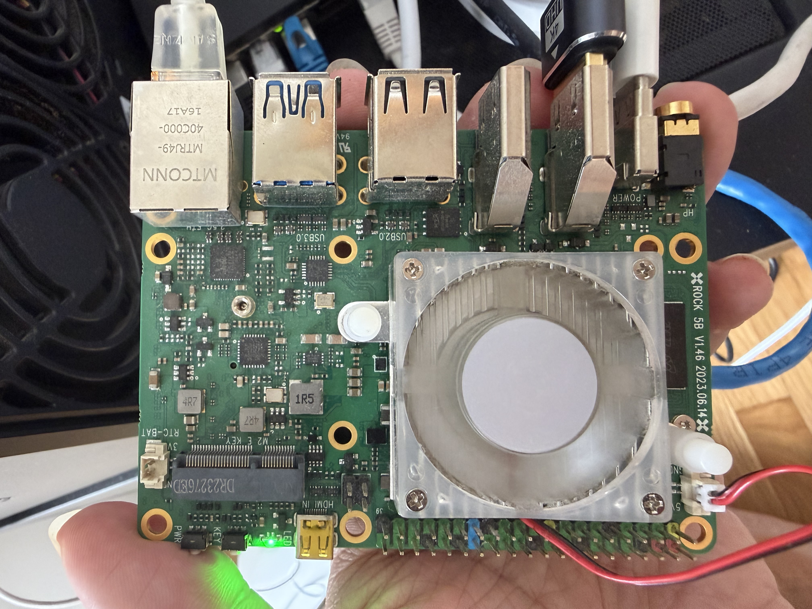
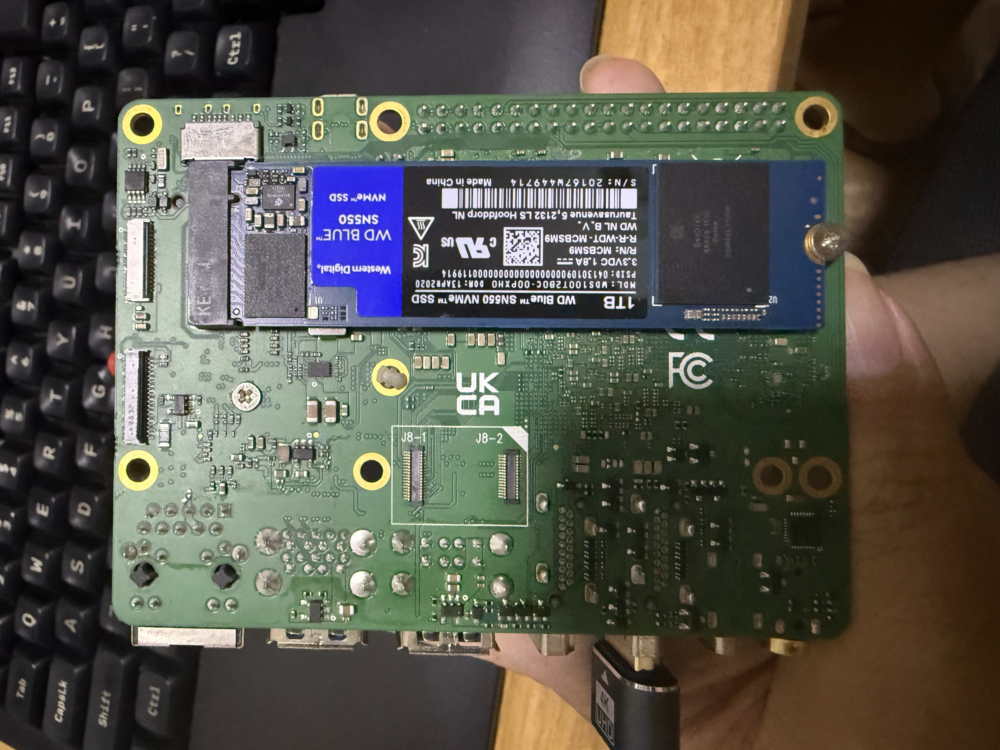
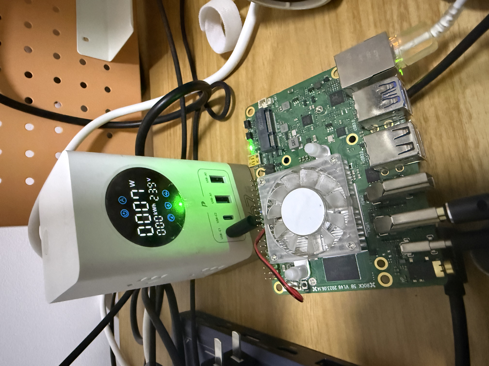
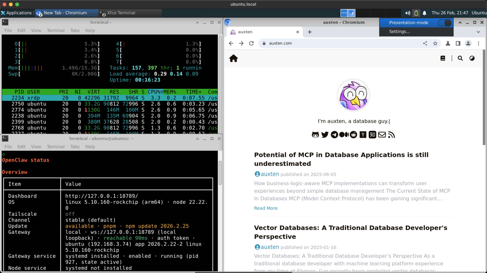
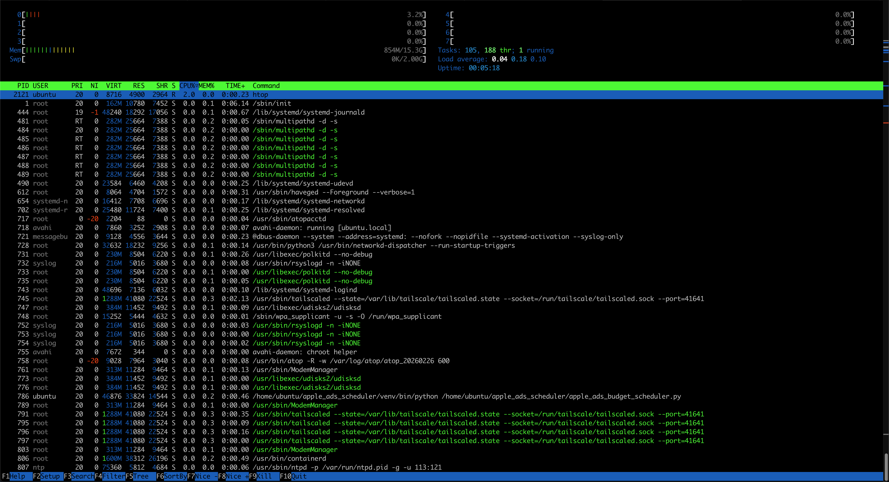
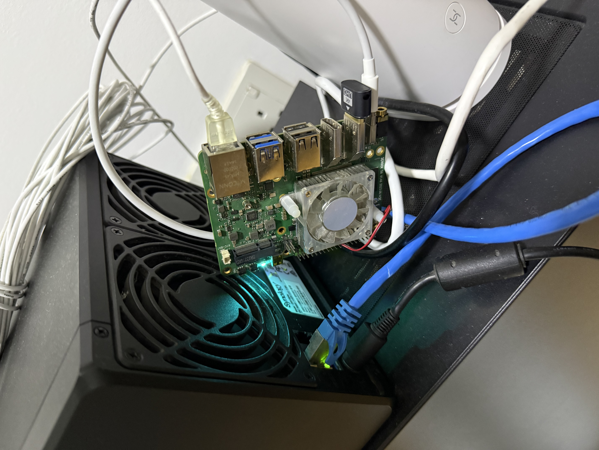
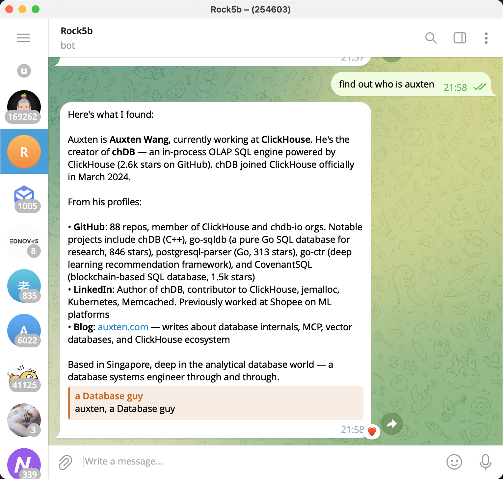

# My $182 ARM SBC draws 7 watts and runs a full AI agent with browser automation. Here's every stupid problem I hit getting there.

So I had this Rock 5B (RK3588, 16GB RAM, 1TB NVMe) sitting around running headless Ubuntu 22.04. Thought it'd be fun to turn it into a self-hosted OpenClaw box with WhatsApp integration and remote desktop.




## The Good Part

Installed XFCE4 + xrdp + Chromium in parallel via SSH. Chromium even came from a Rockchip-specific PPA with hardware-accelerated video decoding (`+rkmpp1` build). Nice.

xrdp was up quickly. Chromium took a bit longer because of dpkg lock contention with the other installs. Node.js 22 install? Timed out waiting for the lock and just gave up. First sign of trouble.

Side note on the RDP client: on macOS, you need Microsoft's RDP app. Except they renamed it to **"Windows App."** A macOS app for connecting to a Linux machine, called "Windows App." Searching "remote desktop" or "RDP" or even "Microsoft Remote Desktop" on the Mac App Store won't find it. You have to search "Windows App." The app itself is great though — smooth, supports dynamic resolution, clipboard sync. Just... the name.

## The Node.js Version War

Re-ran the nodesource setup for Node 22. It "succeeded." Except it installed... Node 16.

Turns out the Rockchip multimedia PPA had pinned `nodejs 16.15.1+j-2` at **priority 1001**, steamrolling nodesource's Node 22 at priority 600. Had to force it:

```
sudo apt install -y nodejs=22.22.0-1nodesource1
```

## The Broken npm Saga

Installed OpenClaw with `npm install -g openclaw@latest`. Worked fine. Went to do something else with npm later — "command not found."

```
$ file /usr/bin/npm
/usr/bin/npm: broken symbolic link to ../lib/node_modules/npm/bin/npm-cli.js
```

When the rockchip PPA's Node 16 was replaced by nodesource's Node 22, the old npm got deleted but the new package's 2,500+ files **silently failed to extract** due to directory conflicts. `dpkg --verify nodejs` showed the entire corepack tree as `missing`.

`sudo apt install --reinstall nodejs=22.22.0-1nodesource1` fixed it. Classic "why does `node --version` work but `npm --version` doesn't" moment.

## OpenClaw Gateway: "You Must Explicitly Tell Me To Exist"

Installed the gateway daemon. It immediately crashed:

```
Gateway start blocked: set gateway.mode=local (current: unset)
```

Fair enough. Set it. Then it started but probe showed "RPC timeout." The gateway needs a moment to fully initialize before it responds to health checks. Not documented anywhere I could find.

## The WhatsApp Plugin: Siccing an AI on a Zod Schema Bug

This is where things got truly spicy.

OpenClaw ships with 37 plugins. Only 4 load by default. WhatsApp is disabled. Every way to enable it fails:

- `openclaw channels login --channel whatsapp` → "Unsupported channel"
- `openclaw plugins enable whatsapp` → `Config validation failed: channels.whatsapp: Unrecognized key: "enabled"`

I pointed Cursor (AI coding assistant) at the Rock 5B over SSH and told it to figure it out. To its credit, it dug *deep* — traced the error to a missing `enabled` field in the compiled Zod schema (`WhatsAppConfigSchema` uses `.strict()` but forgot to declare `enabled`, while `WhatsAppAccountSchema` has it). The gateway tries to auto-enable WhatsApp, writes `enabled: true`, gets rejected by its own validation, and silently gives up. Every restart. A beautiful self-contradicting infinite loop.

Cursor patched the Zod schema across 6 bundle files. Config validation stopped complaining. But then it found the real problem: the stock plugins ship as raw TypeScript in the `extensions/` directory with empty `node_modules/` and `workspace:*` dev dependencies. The `jiti` TypeScript loader chain is broken on ARM64. Config says `enabled: true`, but the plugin never actually registers in the runtime.

After increasingly deep rabbit holes, Cursor gave me the pragmatic recommendation: **just downgrade**.

```
sudo npm install -g openclaw@2026.2.13
```

WhatsApp loaded immediately. QR code scan worked first try. Sometimes the best engineering decision — even for an AI — is knowing when to stop fighting a bug.

## The $2 Hardware Fix Nobody Talks About

The Rock 5B was running headless, which causes all sorts of X server weirdness — inconsistent resolution, rendering glitches, xrdp frame buffer issues. Solution: a **$2 HDMI dummy plug** (3 SGD at a local electronics store).

It's just a tiny dongle with an HPD pull-up resistor and an I2C EEPROM holding EDID data. Plug it in, GPU thinks a 1080p monitor is connected, X server initializes a clean frame buffer. Everything downstream becomes more stable.

Also: XFCE has a **Presentation Mode** toggle right on the battery icon in the taskbar. One click disables all sleep/lock/DPMS. No config files, no systemd tweaks. For a 24/7 automation box, this is all you need.

## The Surprise: Chrome Doesn't Exist on Linux ARM64, but Chromium CDP Is Rock Solid

Here's something I didn't expect: **Google Chrome has no official Linux ARM64 build.** Not "coming soon." Not "beta." Just... doesn't exist. The Chromium dev mailing list has threads about this going back to 2015. Google's reasons: limited ARM build infrastructure, no CI bots for ARM64 Linux, not a priority platform. Meanwhile Vivaldi has shipped ARM64 Linux builds for years, so it's clearly a business decision, not a technical limitation.

Fortunately the Rockchip PPA provides a **patched Chromium 114** with RK3588 MPP hardware video decoding support. And here's the real surprise: **CDP (Chrome DevTools Protocol) stability on this setup is genuinely excellent.** Better than some x86 cloud VMs I've used. Here's my theory on why:

**The HDMI dummy plug enables headed mode — don't use headless.** OpenClaw runs Chromium with a real window, not headless. This matters more than you'd think: headless mode is a CAPTCHA magnet. Anti-bot systems have gotten very good at fingerprinting headless browsers (`navigator.webdriver`, missing plugins, weird WebGL signatures) — it's basically a "I am a robot" sign on your forehead. Headed mode with real display parameters renders identically to a normal user's browser. The dummy plug gives X server stable resolution and refresh rate, so the compositor never gets confused. $2 to sidestep the entire headless detection problem space.

**Chromium 114 dodges the GPU driver minefield.** The RK3588's Mali G610 has known issues with newer Chromium versions (130+) — `failed to load driver: rockchip` errors, broken GPU process initialization. Chromium 114 predates these regressions, falls back gracefully to software rendering, and *just works*. No half-broken hardware acceleration is better than half-broken hardware acceleration.

**CDP doesn't need GPU.** DOM manipulation, network interception, cookie management, screenshots — all CPU/IO bound. The RK3588's four Cortex-A76 cores handle Chromium's main thread easily. 16GB RAM means no OOM kills. NVMe means no profile I/O bottleneck.

**big.LITTLE is accidentally perfect for browser automation.** Browsers are bursty: mostly idle waiting for network, occasionally CPU-intensive for parsing and JS execution. The RK3588 scheduler parks work on A55 efficiency cores during idle, switches to A76 performance cores for computation. This matches browser automation workloads almost perfectly.

**Single-purpose hardware has zero contention.** No noisy neighbors, no GC pauses from competing JVMs, no CPU throttling. The CDP WebSocket connection stays low-latency and stable indefinitely.

The stability isn't any single factor — it's multiple "accidental" advantages stacking up. An old-enough Chromium avoiding GPU bugs. A $2 dummy plug enabling headed mode. ARM big.LITTLE matching browser workloads. Dedicated hardware eliminating contention. Sometimes "not bleeding edge" is the sweet spot.

## Actually, This Thing Is Fast

I want to push back on the "it's just an SBC" framing. The RK3588's four Cortex-A76 cores at 2.4GHz are roughly on par with an Intel i5-8250U. Running Chromium + OpenClaw + full XFCE desktop, CPU sits under 5% most of the time, spiking to maybe 30-40% during heavy JS execution. 16GB RAM is overkill — the whole stack uses 1-2GB. The 1TB NVMe performs identically to desktop hardware.

For browser automation specifically, this machine isn't "adequate." It's **overpowered**.

And the power draw? I measured it. The whole system — SBC + NVMe + HDMI dummy plug + XFCE desktop + Chromium + OpenClaw gateway — pulls **7 watts steady state**. That's not idle. That's the running system with everything loaded. When OpenClaw opens Chromium and actively browses websites, it goes up to... **8 watts**. One extra watt for active browser automation.



Seven watts. An entire computer running a desktop environment, a browser, and an AI agent, drawing less power than an LED light bulb. Compare that to an Intel N100 mini PC at 10-30W, or an i5 NUC at 15-60W.

Fun aside: the Rock 5B has a PD negotiation bug where the PMIC can't handshake to 10V/20V on boot, so it stays at 5V. At 5V/3A you get 15W max. I used to compile [chDB](https://github.com/chdb-io/chdb) (ClickHouse embedded) on this board which pulls 20W+ at full 8-core load — instant undervoltage reboot. Had to use a PD trigger/decoy board to force 20V output. Lost that gadget in a move, but at 7W for OpenClaw, 15W headroom is plenty. Low power workloads accidentally sidestep a hardware bug.

Quick napkin math:

| Item | Cost |
|------|------|
| Rock 5B 16GB | ~$110 |
| 1TB NVMe | ~$60 |
| HDMI dummy plug | $2 |
| USB-C PD charger | ~$10 |
| **Total** | **~$182** |

A comparable ARM VPS (4 core / 16GB / 1TB) runs $40-80/month. The Rock 5B pays for itself in 3-5 months, then it's basically free to run (electricity cost is under $1/month). Plus your data stays local — for something like OpenClaw that handles personal messages and browser sessions, that matters.

## TL;DR

**Final cost: ~$182 in hardware and mass psychological scars from reading minified Zod schemas.**

The Rock 5B is now a fully operational self-hosted OpenClaw box with WhatsApp, Chromium browser automation, and remote desktop. It runs 24/7, sips power, and the CDP connection hasn't dropped once in days. Honestly the most reliable browser automation setup I've run, and it's a ~$100 SBC with a $2 fake monitor drawing less power than a desk lamp.


*The final setup via RDP: htop showing 8 cores barely awake, OpenClaw gateway running, Chromium browsing normally. Note "Presentation mode" toggle in the top right.*


*htop detail: 8 cores all single-digit %, 854MB/15.3GB RAM, load average 0.04. This machine is bored.*


*The final resting place: Rock 5B leaning against my Synology NAS, freeloading off its exhaust fans. I didn't bother configuring PWM to spin up the board's own fan — at 7W the SoC runs cool. The hottest part is actually the NVMe SSD on the back, and the NAS exhaust blows right onto it. Free cooling from the neighbor.*


*The payoff: asked the "Rock5b" bot on Telegram to "find out who is auxten." It autonomously opened Chromium, searched the web, and returned a full summary. All on a 7W SBC sitting behind my NAS.*

For anyone running home automation, AI agents, or browser automation — an ARM SBC might genuinely be the ideal form factor. Not "good enough for the price," but actually better than cloud or x86 alternatives for this specific workload. The low power, zero contention, always-on nature of the hardware matches the always-on nature of the software perfectly.

**Edit:** If you're considering this setup, go straight to OpenClaw v2026.2.13 and save yourself the Zod schema therapy session. Buy the HDMI dummy plug ($2). And don't fight the Rockchip PPA's Node.js pinning — force-install from nodesource immediately.

**Edit 2:** Shameless plug (literally) — if you'd rather run OpenClaw on a Mac Mini instead of an SBC, you hit the same problems: sleep prevention, virtual display, audio routing. I built [MacMate](https://macmate.app/) to solve exactly this. It's a native macOS app that does what XFCE Presentation Mode + HDMI dummy plug do on Linux, but without the hardware. Virtual displays via CGVirtualDisplay API, awake management, audio loopback — $18 one-time. Full disclosure: this is my own product. That said, you'd be trading 7W power draw for... whatever a Mac Mini pulls. Can't win them all.
